<p align="center">
  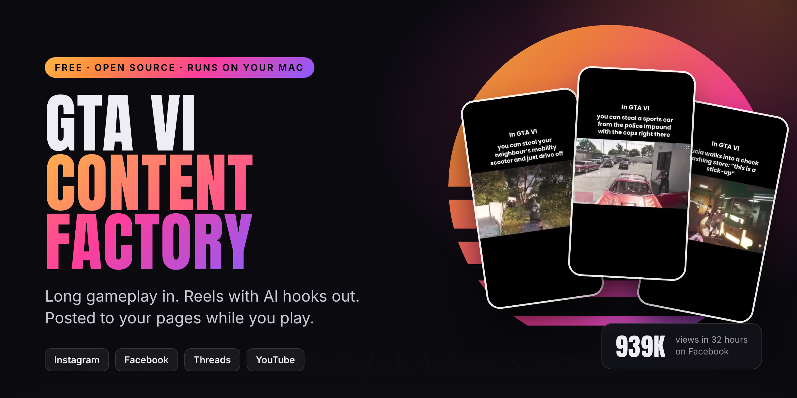
</p>

<p align="center">
  <a href="https://github.com/priyanshuratnakar/gta-vi-content-factory/stargazers"></a>
  <a href="https://x.com/0xratnakar"></a>
  
  <a href="LICENSE"></a>
</p>

<p align="center">
  <b>Drop in a long GTA VI stream. Get reels with hooks, long-form parts and thumbnails, posted to Instagram, Facebook and Threads on a schedule.</b><br>
  Runs 100% on your Mac. Free and open source. Use it in your browser or right in the terminal.
</p>

<p align="center">
  <a href="#-install-3-minutes">Install</a> ·
  <a href="#-how-it-works">How it works</a> ·
  <a href="#-a-look-inside">Screenshots</a> ·
  <a href="#-let-ai-set-it-up-for-you">Let AI set it up</a> ·
  <a href="#-faq">FAQ</a>
</p>

<br>

## 📈 It works

<p align="center">
  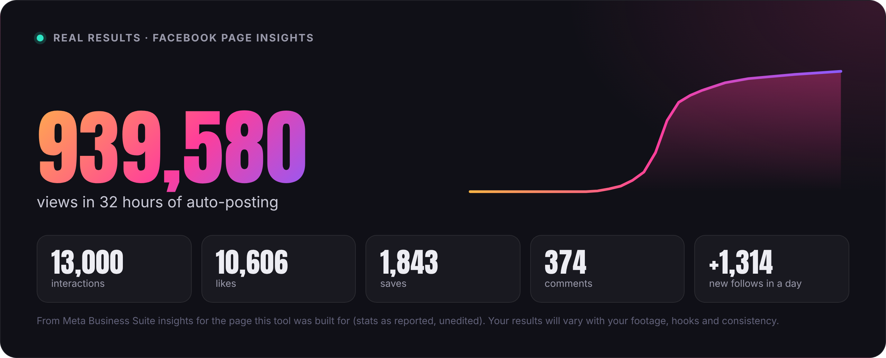
</p>

This tool started as the scripts behind a GTA VI page. In 32 hours of auto-posting, its Facebook reels reached **939,580 views** and **13,000 interactions**, and the page gained **1,314 followers in a single day**. Those scripts became this app, so anyone can run the same playbook.

<details>
<summary><b>See the raw Meta insights</b></summary>
<br>
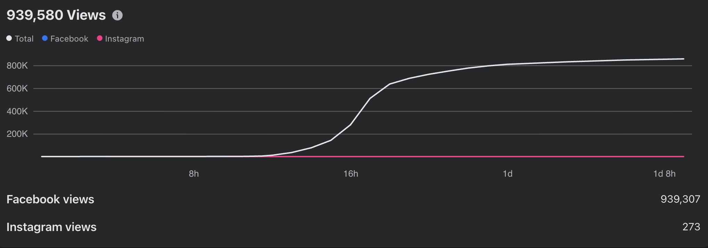
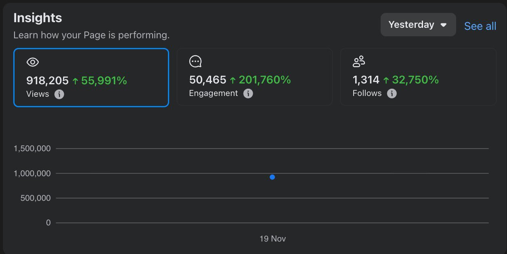
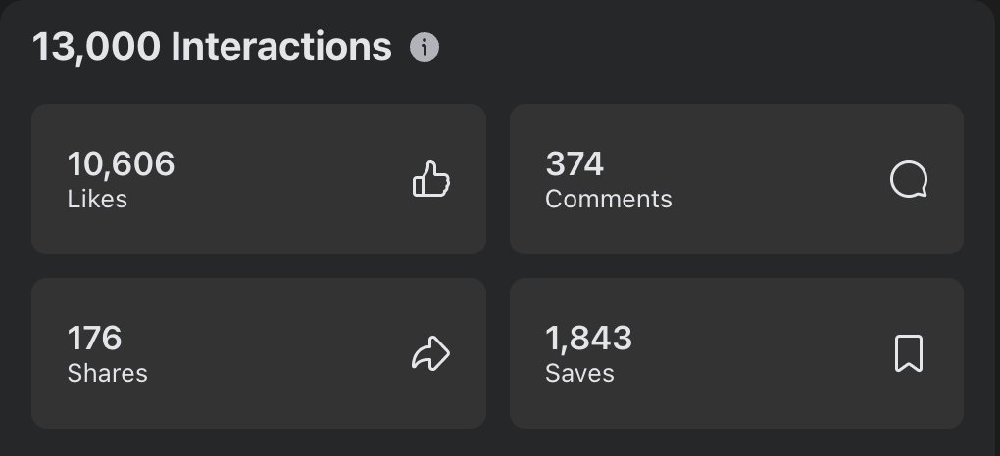
</details>

<br>

## ⚡ Install (3 minutes)

```bash
git clone https://github.com/priyanshuratnakar/gta-vi-content-factory.git
cd gta-vi-content-factory
./install.sh
```

That's it. The installer sets up Homebrew (if needed), ffmpeg, yt-dlp, cloudflared and a private Python, then opens the app at **http://localhost:8765** with a setup checklist. Next time, double-click **`start.command`**.

> Apple Silicon (M1 or newer) recommended. Intel Macs work; local AI is slower.

<br>

## 🎬 How it works

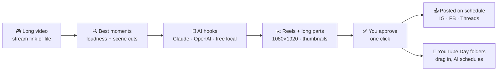

| | What you get |
|---|---|
| 🔍 **Clipping that watches the video** | Loudness and scene changes find the action. An AI looks at each moment and writes a hook like *"In GTA VI, an NPC climbs back into his burning car just so he can sue 💀"*. |
| 📱 **Reels that look like a real page** | 1080×1920, your header and hook above the clip, inside the safe zone, 25 seconds (the length Instagram's API reliably accepts). |
| 🎞️ **Long-form too** | The full session is cut into 25-minute parts with thumbnails in 3 styles. Use your own art as the background. |
| ✅ **Nothing posts without you** | Watch every reel, fix a hook (it re-renders), then approve all with one click. |
| 🤖 **Hands-off posting** | Official Instagram, Facebook and Threads APIs. Your schedule, daily limits respected, never double-posts, keys auto-extended, Mac kept awake. |
| ▶️ **YouTube without the audit** | Day folders with titles, thumbnails and descriptions. Drag them into Studio and let AI schedule them. |
| ✨ **Setup an AI can do for you** | Every step has a "Let AI do it" button that copies a prompt for Claude in Chrome. |
| 💻 **Browser or terminal** | A clean web dashboard, or a live terminal dashboard. Same engine. |

<br>

## 👀 A look inside

<table>
  <tr>
    <td width="50%">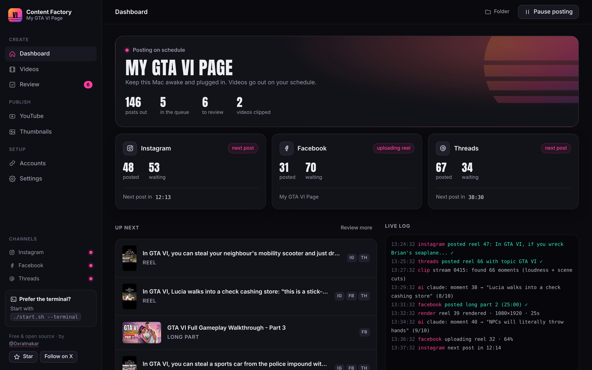<br><p align="center"><b>Dashboard</b><br><sub>Every channel, what's next and a live log</sub></p></td>
    <td width="50%">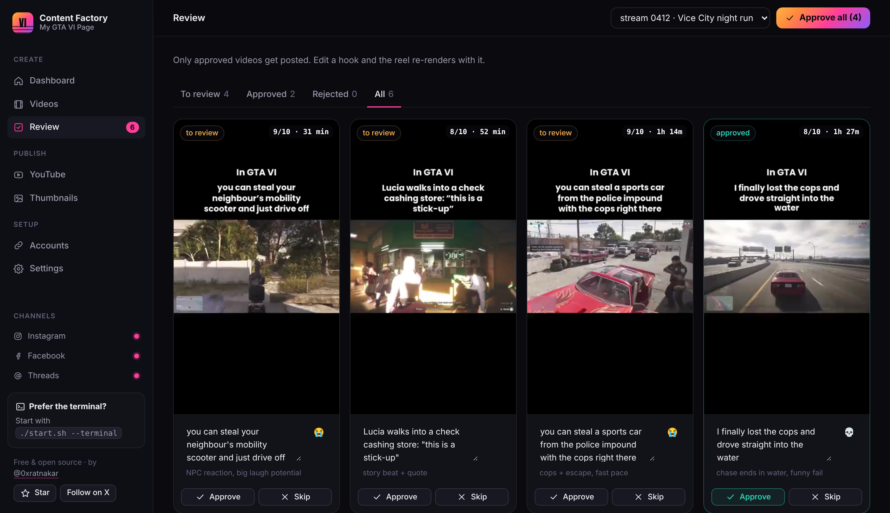<br><p align="center"><b>Review</b><br><sub>Watch, edit the hook, approve</sub></p></td>
  </tr>
  <tr>
    <td width="50%">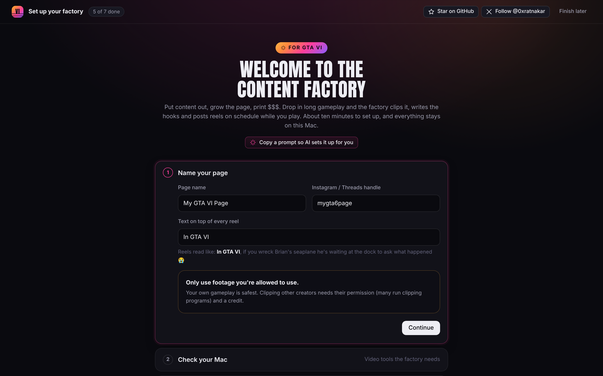<br><p align="center"><b>Setup checklist</b><br><sub>About ten minutes, one step at a time</sub></p></td>
    <td width="50%">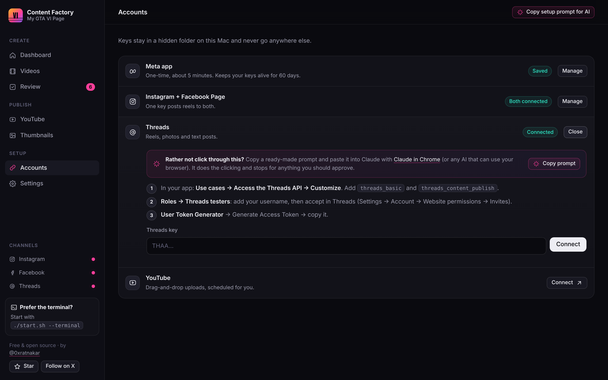<br><p align="center"><b>Accounts</b><br><sub>Exact clicks for every key, or let AI do it</sub></p></td>
  </tr>
</table>

### Prefer the terminal?

<p align="center">
  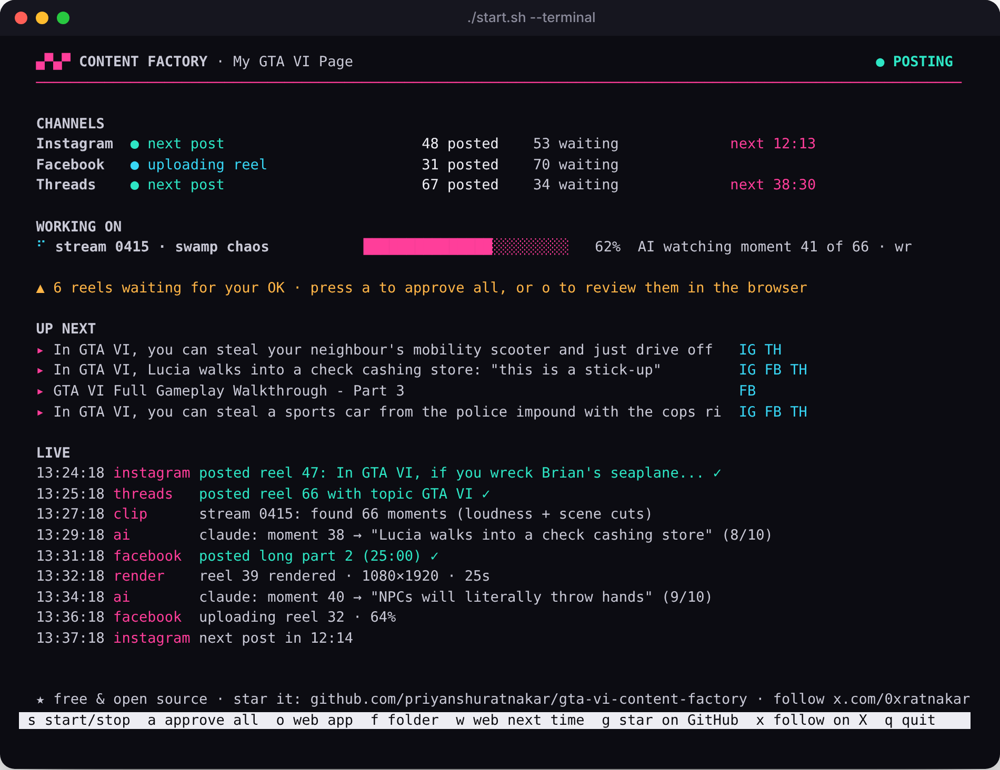
</p>

Setup happens in the browser once. After that, pick how you run it:

```bash
./start.sh --terminal        # live terminal dashboard
./start.sh --web             # browser dashboard (default)
./start.sh add <link|file>   # hand a video to a running factory
./start.sh status            # quick summary
```

Terminal keys: <kbd>s</kbd> start/stop posting · <kbd>a</kbd> approve all · <kbd>o</kbd> open the web app · <kbd>f</kbd> folder · <kbd>g</kbd> star on GitHub · <kbd>x</kbd> follow on X · <kbd>q</kbd> quit

<br>

## ✨ Let AI set it up for you

Meta's developer pages are the only fiddly part. Every row on the **Accounts** page has a **Let AI do it** button that copies a ready-made prompt, filled in with your page name. Paste it into Claude with [Claude in Chrome](https://claude.ai/chrome) (or any AI that can use your browser) and it does the clicking.

The prompts tell the AI to stop for anything you should approve. It never types your passwords, and you paste the keys in yourself. There's also a **Copy setup prompt for AI** button that walks an AI through the whole checklist.

<br>

## 🗓️ Your first day

1. **Setup checklist.** Name your page, pick the AI, connect accounts, pick a thumbnail style.
2. **Add a long video.** Paste a link to your stream VOD, or drop a file into `~/GTA VI Content Factory/Drop videos here`.
   <sub>Tip: on PS5 or Xbox, stream to a private or unlisted YouTube channel while you play, then paste the link.</sub>
3. **Review.** Watch the reels, edit any hook, press **Approve all**.
4. **Start posting.** Leave the Mac on and plugged in. The dashboard shows what's next.
5. **YouTube.** Press **Make Day folders**, drag one into YouTube Studio, and let AI schedule it.

<br>

## 🧠 AI options

| Option | Cost | Quality | Needs |
|---|---|---|---|
| **Claude** | a few cents per long video | best hooks | Anthropic API key |
| **OpenAI** | similar | great | OpenAI API key |
| **Free local** | free | good, slower | [Ollama](https://ollama.com) + `ollama pull qwen2.5vl:7b` |
| **No AI** | free | you write the hooks | nothing |

Speech-to-text (better hooks when people talk in the video) installs automatically on Apple Silicon.

## 📏 Platform limits (built in)

| Platform | How | Limit the factory respects |
|---|---|---|
| Instagram | Graph API (your Meta app) | ~50 posts / 24h; reels ≤ ~30s on some accounts |
| Facebook Page | Graph API | 30 API reels / 24h; long videos up to 4h |
| Threads | Threads API | 250 posts / 24h |
| YouTube | Studio drag-and-drop + AI scheduling | your channel's daily upload limit |
| X | not yet (paid API) | |

<br>

## ❓ FAQ

<details>
<summary><b>Does it cost anything?</b></summary>
<br>
The app is free. Posting uses free official APIs. The only optional cost is the AI: a few cents per long video with Claude or OpenAI, or nothing with local Ollama.
</details>

<details>
<summary><b>Where do my keys and videos go?</b></summary>
<br>
Nowhere. Everything stays on your Mac in <code>~/GTA VI Content Factory</code>. Keys live in a hidden folder that only your user can read.
</details>

<details>
<summary><b>Can I clip other streamers?</b></summary>
<br>
Only with permission. Many streamers run clipping programs. Add a credit line in Settings. Re-uploading other people's videos without permission gets pages struck. Your own gameplay is always safest.
</details>

<details>
<summary><b>Why does YouTube need dragging?</b></summary>
<br>
Google keeps uploads from apps that haven't passed its audit private. Dragging into Studio is the workaround, and an AI with browser access can schedule the drafts for you.
</details>

<details>
<summary><b>Does my Mac need to stay on?</b></summary>
<br>
Yes, while it posts. Keep it plugged in. The factory keeps it awake on its own.
</details>

<details>
<summary><b>Where are things saved?</b></summary>
<br>

```
~/GTA VI Content Factory/
  Drop videos here/      drop long videos here
  Projects/              one folder per video: source, reels, long parts, covers
  YouTube uploads/       Day folders to drag into YouTube Studio
  Cover backgrounds/     your own thumbnail art
  queue.json             what's approved and what's been posted where
  logs/                  everything the factory did
  _to_delete/            replaced files (the factory never deletes your stuff)
```
</details>

<br>

## 🛣️ Roadmap

- [x] Web dashboard + terminal dashboard
- [x] "Let AI do it" setup prompts
- [ ] Trial Reels on Instagram (for eligible accounts)
- [ ] Threads photo and question posts between reels
- [ ] X / Twitter (bring your own paid API key)
- [ ] Follower and views dashboard
- [ ] Windows support

## 🧩 Claude skills (optional)

`skills/` has step-by-step skills Claude can follow in your browser: **meta-setup** (Meta app and keys), **page-setup** (names, bios and links everywhere) and **youtube-studio-scheduler** (details, thumbnails and schedule for your drafts).

## 🤝 Contributing

Issues and PRs are welcome. Keep the UX simple enough for someone who has never opened Terminal.

## ⚖️ License and legal

[AGPL-3.0](LICENSE). Free to use, change and share. If you run a modified version as a service for others, you must share your changes under the same license.

Use footage you're allowed to use; you're responsible for what you post. Not affiliated with Rockstar Games or Take-Two Interactive. "Grand Theft Auto" and "GTA" are their trademarks.

<br>

<p align="center">
  <b>If this helps your page, a ⭐ helps a lot.</b><br><br>
  <a href="https://github.com/priyanshuratnakar/gta-vi-content-factory/stargazers"></a>
  <a href="https://x.com/0xratnakar"></a>
  <a href="https://github.com/priyanshuratnakar"></a>
</p>
